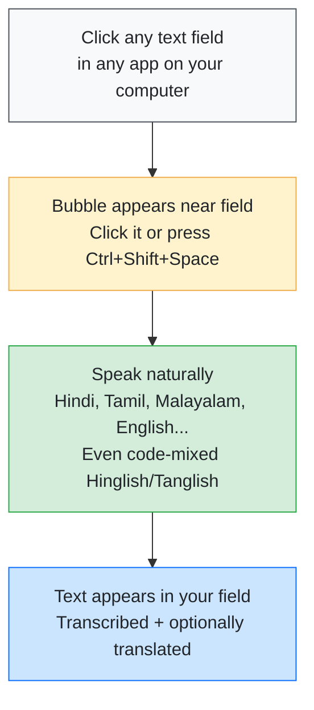
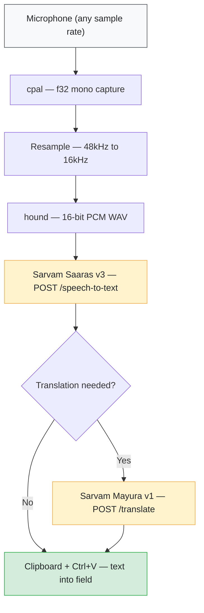

<p align="center">
  
</p>

<h1 align="center">VaaniFlow</h1>

<p align="center">
  <strong>Speak any Indian language. Type anywhere.</strong>
</p>

<p align="center">
  <a href="https://github.com/alpha912/VaaniFlow/blob/main/LICENSE"></a>
  <a href="https://tauri.app/"></a>
  <a href="https://www.rust-lang.org/"></a>
  <a href="https://react.dev/"></a>
  <a href="https://www.sarvam.ai/"></a>
  <a href="https://github.com/alpha912/VaaniFlow/actions/workflows/ci.yml"></a>
</p>

<p align="center">
  <sub>A tiny desktop app that puts a floating bubble near any text field.<br/>Click the bubble, speak in any of 22+ Indian languages, and the text flows right in.</sub>
</p>

---

## How It Works



## Features

- **22+ Indian Languages** — Hindi, Tamil, Telugu, Kannada, Malayalam, Bengali, Gujarati, Marathi, Punjabi, Odia, Assamese, Urdu, Nepali, and more
- **Code-Mixed Speech** — Hinglish, Tanglish, Manglish — speak however you naturally do
- **Live Translation** — Set a destination language and VaaniFlow transcribes + translates in one go
- **Smart Floating Bubble** — Appears near active text fields automatically. Draggable. Unobtrusive.
- **Global Hotkey** — `Ctrl+Shift+Space` (customisable) — works from any app
- **Microphone Picker** — Choose from all available input devices in Settings
- **Privacy First** — Your API key, your data. Calls go directly from your machine to Sarvam's servers. No telemetry, no accounts, no middlemen.
- **Tiny Footprint** — Rust + Tauri v2 = ~2 MB binary. No Electron. No bloat.

## Tech Stack

| Layer | Technology |
| :------ | :----------- |
| **Frontend** | React 19, TypeScript 5, Vite 7 |
| **Backend** | Rust (2021 edition), Tauri v2 |
| **Audio** | cpal capture, hound WAV, 16kHz resampling |
| **Speech-to-Text** | Sarvam Saaras v3 |
| **Translation** | Sarvam Mayura v1 |
| **Platform** | Win32 APIs (Windows), AppleScript (macOS) |

## Quick Start

### Prerequisites

| Tool | Version | Link |
| :------ | :-------- | :------ |
| Rust | stable | [rustup.rs](https://rustup.rs/) |
| Node.js | 18+ | [nodejs.org](https://nodejs.org/) |
| Tauri CLI | 2.x | `cargo install tauri-cli` |
| Sarvam API Key | free tier | [sarvam.ai](https://www.sarvam.ai/) |

> Free tier gives you **1,000 credits** — roughly **33 hours** of speech recognition.

### Install & Run

```bash
# Clone the repo
git clone https://github.com/alpha912/VaaniFlow.git
cd VaaniFlow

# Install frontend dependencies
npm install

# Create your env file
echo "VITE_SARVAM_API_KEY=your_api_key_here" > .env.development

# Launch in dev mode
cargo tauri dev
```

### Build for Production

```bash
cargo tauri build
```

## Usage

1. **Launch VaaniFlow** — A small orange bubble appears on screen
2. **Click a text field** — Gmail, VS Code, Slack, WhatsApp Web, Notes...
3. **Bubble glows** — It detected the text field
4. **Click bubble / hotkey** — Recording starts (bubble pulses)
5. **Speak naturally** — Any Indian language, any accent
6. **Click again / hotkey** — Recording stops
7. **Text appears** — Transcribed (+ translated) into your field

### Settings

Right-click the bubble **> Settings** to configure:

| Setting | Description |
| :-------- | :------------ |
| **API Key** | Your Sarvam API key (with built-in validation) |
| **Source Language** | Pick a language or `Auto-detect` for all 22+ |
| **Destination Language** | `Same as source` to skip translation, or pick a target |
| **Global Hotkey** | Default: `Ctrl+Shift+Space` |
| **Microphone** | Pick from all input devices, or use System Default |

## Architecture

### Audio Pipeline



### Smart Routing

| Your Setting | What Happens | API Calls |
| :------------- | :------------- | :---------- |
| **Same as source** | Transcribe in original language | `1` — Saaras v3 `mode=transcribe` |
| **English** | Speech directly to English | `1` — Saaras v3 `mode=translate` |
| **Other Indian language** | Transcribe + translate | `2` — Saaras v3 + Mayura v1 |

## Supported Languages

### Speech-to-Text — Saaras v3

| Code | Language | Code | Language |
| :------- | :----------- | :------- | :----------- |
| `hi-IN` | Hindi | `ta-IN` | Tamil |
| `te-IN` | Telugu | `kn-IN` | Kannada |
| `ml-IN` | Malayalam | `bn-IN` | Bengali |
| `gu-IN` | Gujarati | `mr-IN` | Marathi |
| `pa-IN` | Punjabi | `or-IN` | Odia |
| `en-IN` | English | `as-IN` | Assamese |
| `ur-IN` | Urdu | `ne-IN` | Nepali |
| `auto` | Auto-detect | | |

### Translation — Mayura v1

All of the above **plus**:

| Code | Language | Code | Language |
| :------- | :----------- | :------- | :----------- |
| `brx-IN` | Bodo | `doi-IN` | Dogri |
| `kok-IN` | Konkani | `ks-IN` | Kashmiri |
| `mai-IN` | Maithili | `mni-IN` | Manipuri |
| `sa-IN` | Sanskrit | `sat-IN` | Santali |
| `sd-IN` | Sindhi | | |

## Platform Notes

<details>
<summary><strong>Windows — Microphone Access</strong></summary>

VaaniFlow needs microphone access. If Windows blocks it, the app will **automatically open** your mic privacy settings.

1. Open **Settings > Privacy & Security > Microphone**
2. Ensure **Microphone access** is ON
3. Scroll down — ensure **Let desktop apps access your microphone** is ON

</details>

<details>
<summary><strong>macOS — Accessibility Permission</strong></summary>

VaaniFlow needs Accessibility access to detect which app is in focus and simulate paste.

1. Build and run the app once
2. Open **System Settings > Privacy & Security > Accessibility**
3. Enable **VaaniFlow**

</details>

## Project Structure

```
VaaniFlow/
├── src/                          # Frontend (React + TypeScript)
│   ├── App.tsx                   # Settings window
│   ├── BubbleApp.tsx             # Floating bubble UI + recording logic
│   ├── Bubble.tsx                # Bubble window entry point
│   ├── main.tsx                  # Settings window entry point
│   └── styles.css                # Shared styles
│
├── src-tauri/                    # Backend (Rust + Tauri v2)
│   └── src/
│       ├── main.rs               # Tauri commands, routing, hotkey
│       ├── audio.rs              # Mic capture, WAV encoding, resampling
│       ├── sarvam.rs             # Sarvam API client (STT + translate)
│       ├── config.rs             # Settings persistence (JSON)
│       └── focus_monitor.rs      # Cross-app text field detection
│
├── .env.development              # Dev API key (gitignored)
├── package.json                  # Frontend dependencies
└── src-tauri/Cargo.toml          # Rust dependencies
```

## API Reference

| API | Endpoint | Model | Purpose |
| :---- | :--------- | :------ | :-------- |
| Speech-to-Text | `POST /speech-to-text` | `saaras:v3` | Transcription + speech-to-English |
| Translate | `POST /translate` | `mayura:v1` | Text-to-text between Indian languages |

- **Base URL:** `https://api.sarvam.ai`
- **Supported audio formats:** WAV, MP3, AAC, AIFF, OGG, OPUS, FLAC, MP4/M4A, AMR, WMA, WebM, PCM
- **Max recording length:** 30 seconds per call

## Contributing

PRs are welcome! Here are some areas that need work:

- **Linux support** — AT-SPI2 text-field detection
- **Streaming STT** — WebSocket-based real-time transcription
- **Custom vocabulary** — Personal dictionary sync
- **Waveform visualisation** — Better recording feedback

## License

MIT — see [LICENSE](./LICENSE)

<p align="center">
  <sub>Built with Rust, React, and Sarvam AI</sub>
</p>
